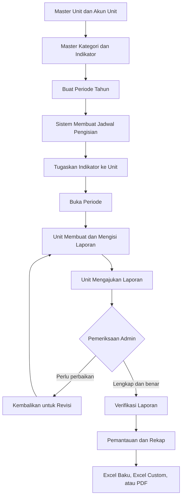
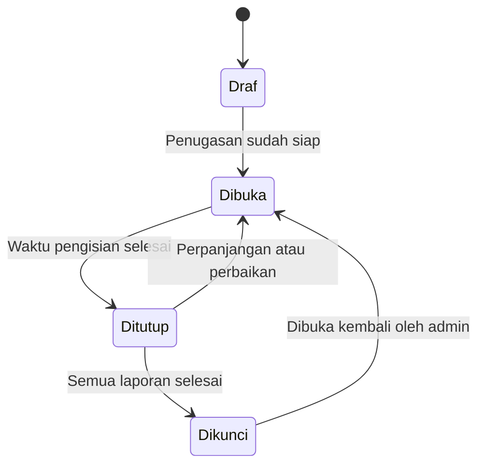
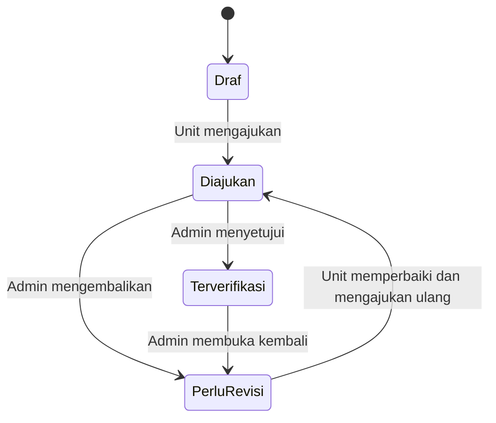
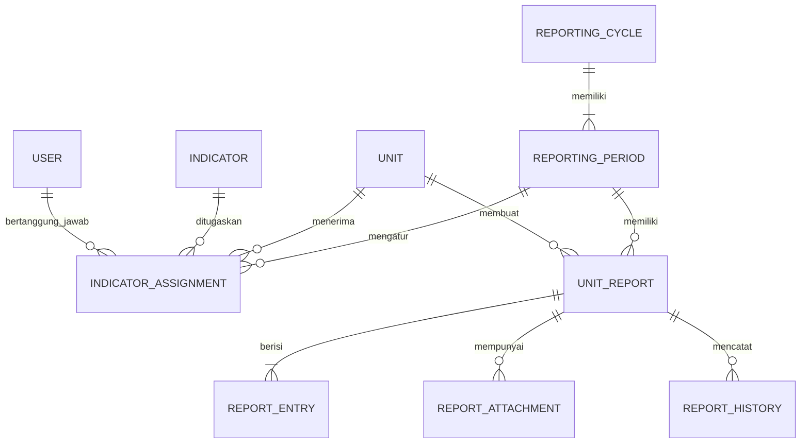

# Panduan Periode Pelaporan SIBLU

Dokumen ini menjelaskan cara kerja fitur **Periode Tahun** pada SIBLU dari persiapan data sampai laporan akhir. Penjelasan mengikuti perilaku aplikasi yang tersedia saat ini.

## Cara menggunakan panduan ini

Jika baru mempelajari SIBLU, baca bagian 1 sampai 7 terlebih dahulu untuk memahami hubungan master, periode, dan penugasan. Setelah itu:

- admin mempelajari bagian 8 sampai 18;
- operator unit memusatkan perhatian pada bagian 9 dan 10;
- pimpinan memusatkan perhatian pada bagian 14 dan 15;
- pengembang dapat membaca bagian 19 dan 20 untuk memahami batas fitur dan hubungan data.

Bagian terpenting:

- [Cara membuat periode tahun](#5-cara-membuat-periode-tahun)
- [Arti status periode](#6-status-periode)
- [Penugasan indikator kepada unit](#7-menugaskan-indikator-kepada-unit)
- [Proses pengisian unit](#9-proses-pengisian-oleh-unit)
- [Pemeriksaan dan verifikasi](#11-pemeriksaan-dan-verifikasi-oleh-admin)
- [Rekap dan laporan akhir](#15-rekap-dan-laporan-akhir)
- [Contoh alur tahun 2026](#16-contoh-alur-lengkap-tahun-2026)
- [Checklist operasional admin](#18-checklist-operasional-admin)

## 1. Tujuan fitur periode

Periode adalah kerangka waktu yang mengatur kapan unit mengisi laporan. Periode menghubungkan seluruh proses berikut:

1. admin menyiapkan master unit, akun, kategori, dan indikator;
2. admin membuat satu tahun pelaporan dan memilih pola pengisian;
3. sistem membuat jadwal pengisian dalam tahun tersebut;
4. admin menugaskan indikator dan penanggung jawab kepada unit;
5. admin membuka jadwal yang sudah siap;
6. unit membuat, menyimpan, dan mengajukan laporan;
7. admin memeriksa dan memverifikasi laporan;
8. pimpinan dan admin memantau hasil;
9. laporan terverifikasi masuk ke rekap dan ekspor.

Alur utamanya adalah:

## 2. Istilah yang perlu dibedakan

### Periode tahun

Periode tahun adalah wadah utama untuk satu tahun pelaporan, misalnya **2026**. Di dalam sistem, data ini disebut `ReportingCycle`.

Satu periode tahun mempunyai:

- tahun;
- pola pengisian;
- pembuat periode;
- beberapa jadwal pengisian.

Satu tahun hanya boleh dibuat satu kali. Sebagai contoh, jika tahun 2026 sudah dibuat dengan pola triwulanan, tahun 2026 tidak dapat dibuat lagi dengan pola bulanan.

### Jadwal pengisian

Jadwal pengisian adalah bagian-bagian di dalam periode tahun. Di dalam sistem, data ini disebut `ReportingPeriod`.

Contohnya:

- Januari 2026 untuk pola bulanan;
- TW 1 / 2026 untuk pola triwulanan;
- Semester 1 / 2026 untuk pola semesteran.

Setiap jadwal memiliki batas pengisian dan status sendiri. Artinya, admin dapat membuka TW 1 tetapi tetap membiarkan TW 2 dalam status Draf.

### Status periode dan status laporan

Keduanya merupakan hal yang berbeda:

- **status periode** mengatur apakah waktu pengisian sedang disiapkan, dibuka, ditutup, atau dikunci;
- **status laporan** menunjukkan posisi pekerjaan satu unit, mulai dari Draf sampai Terverifikasi.

Menutup periode tidak otomatis mengubah laporan Draf menjadi Diajukan. Memverifikasi laporan juga tidak otomatis mengunci periodenya.

## 3. Hak akses setiap peran

| Kegiatan | Admin | Unit | Pimpinan |
|---|:---:|:---:|:---:|
| Mengelola master unit dan akun | Ya | Tidak | Tidak |
| Mengelola kategori dan indikator | Ya | Tidak | Tidak |
| Membuat periode tahun | Ya | Tidak | Tidak |
| Mengubah status jadwal | Ya | Tidak | Tidak |
| Menugaskan indikator ke unit | Ya | Tidak | Tidak |
| Mengimpor data historis | Ya | Tidak | Tidak |
| Membuat dan mengisi laporan unit | Tidak | Ya, untuk unit sendiri | Tidak |
| Mengajukan laporan | Tidak | Ya, untuk unit sendiri | Tidak |
| Memberi catatan dan memverifikasi | Ya | Tidak | Tidak |
| Melihat laporan unit | Ya | Hanya unit sendiri | Ya |
| Melihat pemantauan dan rekap | Ya | Sesuai unit sendiri | Ya |
| Mengekspor laporan | Ya | Sesuai akses unit | Ya |

## 4. Data yang harus siap sebelum membuat periode

Pembuatan periode hanya membuat tahun dan jadwal. Periode tidak otomatis membuat unit, akun, kategori, indikator, atau penugasan.

Sebelum mulai, admin sebaiknya menyelesaikan master berikut.

### 4.1 Unit Kerja

Setiap unit harus memiliki:

- kode unit yang unik;
- nama unit;
- status aktif;
- unit induk jika diperlukan.

Menu: **Master SIBLU → Unit Kerja**.

### 4.2 Akun unit

Unit yang akan mengisi harus mempunyai minimal satu akun aktif dengan role **UNIT** dan terhubung ke unit tersebut.

Akun ini diperlukan untuk dua hal:

- pengguna yang masuk dan mengisi laporan;
- penanggung jawab yang dipilih pada penugasan indikator.

Jika daftar penanggung jawab kosong saat membuat penugasan, periksa akun unit terlebih dahulu.

### 4.3 Kategori indikator

Kategori mengelompokkan indikator yang sejenis, misalnya Mahasiswa, Lulusan, Penelitian, SDM, dan Kerja Sama.

Menu: **Master SIBLU → Kategori Indikator**.

### 4.4 Formulir dan indikator

Indikator menentukan struktur isian yang akan diterima unit. Beberapa pengaturan pentingnya adalah:

- bentuk formulir: tunggal, tabel tetap, atau tabel dinamis;
- field yang harus diisi;
- field hasil rekap;
- metode rekap;
- arah kinerja;
- kewajiban penjelasan;
- kewajiban lampiran;
- status aktif dan versi indikator.

Definisi indikator akan disalin ke laporan saat laporan pertama kali dibuat. Karena itu, perubahan master indikator setelah laporan terbentuk tidak mengubah struktur laporan lama.

## 5. Cara membuat periode tahun

Menu: **Master SIBLU → Periode Tahun**.

Langkahnya:

1. tekan **Buat Periode Tahun**;
2. isi tahun pelaporan antara 2000 sampai 2100;
3. pilih pola pengisian;
4. tekan **Buat Periode**;
5. sistem membuat seluruh jadwal dalam status **Draf**.

### Pilihan pola pengisian

| Pola | Jumlah jadwal | Nama jadwal | Batas yang dibuat otomatis |
|---|---:|---|---|
| Bulanan | 12 | Januari sampai Desember | Hari terakhir setiap bulan |
| Triwulanan | 4 | TW 1 sampai TW 4 | 31 Maret, 30 Juni, 30 September, 31 Desember |
| Semesteran | 2 | Semester 1 dan Semester 2 | 30 Juni dan 31 Desember |

Contoh ketika admin membuat tahun **2026** dengan pola **Triwulanan**:

| Jadwal | Batas pengisian awal | Status awal |
|---|---|---|
| TW 1 / 2026 | 31 Maret 2026 | Draf |
| TW 2 / 2026 | 30 Juni 2026 | Draf |
| TW 3 / 2026 | 30 September 2026 | Draf |
| TW 4 / 2026 | 31 Desember 2026 | Draf |

> **Perilaku saat ini:** batas pengisian adalah informasi jadwal. Sistem belum menutup periode secara otomatis ketika tanggal batas terlewati. Admin tetap mengendalikan status periode secara manual.

## 6. Status periode

Admin mengelola status melalui tombol **Kelola Alur** pada tahun yang dipilih.

| Status periode | Fungsi | Dampak utama |
|---|---|---|
| Draf | Tahap persiapan | Unit belum dapat membuat laporan. Admin dapat menyiapkan penugasan. |
| Dibuka | Masa pengisian aktif | Unit dapat membuat dan mengubah laporan Draf atau Revisi. |
| Ditutup | Pengisian unit dihentikan | Unit tidak dapat membuat atau mengubah laporan. Admin masih dapat memeriksa laporan yang sudah diajukan. |
| Dikunci | Periode final | Pengisian dan perubahan status laporan dihentikan sampai periode dibuka kembali. |

Alur operasional yang disarankan:

Aturan sistem yang perlu diketahui:

- periode yang sudah memiliki laporan tidak dapat dikembalikan menjadi Draf;
- setiap perubahan status dicatat di riwayat periode;
- sistem saat ini mengizinkan admin memilih status secara langsung;
- sistem belum memeriksa bahwa seluruh unit sudah terverifikasi sebelum status Dikunci dipilih;
- karena itu, admin harus memeriksa halaman **Pemantauan** sebelum mengunci periode.

### Urutan status yang disarankan

1. pertahankan **Draf** selama master dan penugasan disiapkan;
2. ubah menjadi **Dibuka** setelah seluruh unit dan indikator siap;
3. ubah menjadi **Ditutup** setelah waktu pengisian selesai;
4. selesaikan pemeriksaan, revisi, dan verifikasi;
5. ubah menjadi **Dikunci** setelah laporan sudah final.

## 7. Menugaskan indikator kepada unit

Dari modal **Kelola Alur**, tekan **Atur Unit & Indikator** pada jadwal yang diinginkan. Admin juga dapat membuka halaman penugasan dari menu periode.

Satu penugasan terdiri dari:

- satu jadwal pengisian;
- satu unit;
- satu indikator aktif;
- satu akun penanggung jawab aktif dari unit tersebut;
- pilihan wajib atau opsional.

Aturan penugasannya:

- indikator yang sama tidak boleh ditambahkan dua kali kepada unit yang sama dalam jadwal yang sama;
- penanggung jawab harus berasal dari akun role UNIT yang aktif pada unit terpilih;
- penugasan hanya dapat diubah pada periode Draf atau Dibuka;
- setelah laporan untuk pasangan unit dan periode terbentuk, indikatornya tidak dapat ditambah atau dihapus;
- penguncian tersebut menjaga agar struktur laporan tidak berubah ketika unit sedang mengisi.

Halaman penugasan menampilkan satu baris untuk satu unit. Tekan **Detail Indikator** untuk melihat seluruh indikator unit tersebut, menambah indikator, atau menghapus indikator sebelum laporan terbentuk.

> **Perilaku saat ini:** penugasan dibuat per jadwal. Penugasan TW 1 tidak otomatis disalin ke TW 2, TW 3, atau TW 4.

## 8. Membuka periode untuk unit

Setelah penugasan lengkap:

1. kembali ke **Periode Tahun**;
2. tekan **Kelola Alur**;
3. ubah jadwal yang akan mulai diisi menjadi **Dibuka**;
4. tekan **Simpan Status**.

Admin tidak harus membuka semua jadwal sekaligus. Sebagai contoh, pada bulan Maret admin dapat membuka TW 1 dan mempertahankan TW 2 sampai TW 4 sebagai Draf.

## 9. Proses pengisian oleh unit

Menu unit: **1. Isi Laporan**.

Alurnya:

1. unit memilih periode;
2. unit menekan **Buat / lanjutkan laporan periode terpilih**;
3. sistem memeriksa bahwa periode berstatus Dibuka;
4. sistem memeriksa bahwa unit mempunyai penugasan;
5. sistem membuat satu laporan untuk unit dan periode tersebut;
6. seluruh indikator yang ditugaskan disalin menjadi bagian laporan;
7. unit mengisi data, penjelasan, dan lampiran;
8. unit menyimpan Draf atau mengajukan laporan.

Satu unit hanya mempunyai satu laporan untuk satu jadwal pengisian. Menekan tombol mulai kembali akan membuka laporan yang sama.

### Isi awal laporan

Saat laporan pertama kali dibuat, sistem menyalin:

- definisi dan versi indikator;
- struktur field;
- baris tetap jika formulir bertipe tabel tetap;
- status wajib atau opsional;
- nama penanggung jawab dari penugasan.

Nama penanggung jawab tidak dapat diganti oleh unit saat mengisi karena sumbernya adalah master penugasan.

### Bentuk formulir

| Bentuk | Perilaku |
|---|---|
| Tunggal | Satu baris isian untuk satu indikator. |
| Tabel tetap | Baris sudah disiapkan dari master dan unit hanya mengisi nilainya. |
| Tabel dinamis | Unit dapat menambah dan menghapus baris sesuai kegiatan. |

### Simpan Draf

Draf dapat disimpan walaupun isian belum lengkap. Setiap penyimpanan menambah versi laporan dan mencatat snapshot riwayat.

### Ajukan laporan

Saat diajukan, sistem melakukan validasi lengkap:

- field wajib harus terisi;
- struktur baris harus sesuai definisi indikator;
- indikator yang mewajibkan penjelasan harus memiliki penjelasan;
- pilihan tidak ada kegiatan harus disertai alasan;
- indikator yang mewajibkan bukti harus memiliki lampiran.

Lampiran yang diterima saat ini adalah PDF, JPG, JPEG, PNG, XLSX, dan DOCX dengan ukuran maksimum 10 MB per berkas.

Unit hanya dapat mengubah laporan ketika:

- pengguna mempunyai role UNIT;
- laporan berstatus Draf atau Perlu Revisi;
- periode berstatus Dibuka.

## 10. Status laporan unit

| Status laporan | Arti | Pelaku berikutnya |
|---|---|---|
| Draf | Laporan sedang dikerjakan | Unit |
| Diajukan | Unit sudah mengirim laporan | Admin |
| Perlu Revisi | Admin mengembalikan laporan | Unit |
| Terverifikasi | Laporan disetujui dan menjadi sumber rekap | Admin, pimpinan, dan sistem rekap |

Alur status laporan:

## 11. Pemeriksaan dan verifikasi oleh admin

Menu admin: **Pelaporan Kinerja → Verifikasi Laporan**.

Admin dapat:

- membuka laporan setiap unit;
- melihat persentase kelengkapan indikator wajib;
- membaca seluruh isian dan lampiran;
- memberi catatan untuk seluruh laporan atau indikator tertentu;
- menyelesaikan catatan yang sudah ditindaklanjuti;
- mengembalikan laporan untuk revisi;
- memverifikasi dan mengunci isi laporan sebagai sumber rekap.

### Mengembalikan untuk revisi

Admin wajib mengisi alasan revisi. Sistem membuat catatan verifikasi dan mengubah status laporan menjadi Perlu Revisi. Unit dapat memperbaikinya setelah periode berstatus Dibuka.

### Memverifikasi

Sebelum verifikasi, sistem memeriksa kembali kelengkapan laporan. Verifikasi tidak dapat dilakukan jika masih ada catatan terbuka.

Laporan berstatus Terverifikasi menjadi sumber data resmi untuk rekap. Halaman pemantauan tetap menampilkan seluruh status agar progres setiap unit dapat diperiksa.

### Membuka kembali laporan terverifikasi

Admin dapat mengembalikan laporan Terverifikasi menjadi Perlu Revisi. Versi lama tetap tersedia di riwayat. Selama statusnya Perlu Revisi, laporan tersebut tidak dipakai sebagai hasil terverifikasi sampai disetujui kembali.

## 12. Riwayat dan perlindungan data

SIBLU menyimpan riwayat untuk kebutuhan pemeriksaan:

- perubahan status periode dicatat pada riwayat periode;
- pembuatan laporan dicatat;
- penyimpanan Draf dicatat;
- pengajuan, revisi, dan verifikasi dicatat;
- impor historis dan penambahan lampiran dicatat;
- snapshot isi laporan dan lampiran disimpan pada riwayat laporan.

Laporan juga mempunyai nomor versi. Jika laporan berubah melalui tab atau pengguna lain, penyimpanan dari versi lama akan ditolak dan pengguna diminta memuat ulang. Mekanisme ini mencegah perubahan terbaru tertimpa.

## 13. Impor data historis

Menu admin: **Pelaporan Kinerja → Impor Historis**.

Impor dapat dipakai untuk memasukkan data lama dari Excel dengan aturan berikut:

- hanya admin yang dapat mengimpor;
- periode tujuan harus Dibuka;
- unit dan indikator harus sudah ditugaskan;
- laporan harus masih berstatus Draf;
- impor hanya masuk ke indikator yang masih kosong;
- data lama tidak boleh ditimpa oleh impor baru;
- hasil impor tetap tercatat dalam riwayat laporan.

Lakukan pratinjau dan pemetaan kolom sebelum menyimpan hasil impor sebagai Draf.

## 14. Pemantauan

Menu: **Pelaporan Kinerja → Pemantauan**.

Halaman ini digunakan oleh admin, unit, dan pimpinan sesuai hak aksesnya. Informasi utamanya mencakup:

- jumlah laporan berdasarkan status;
- unit yang sudah mempunyai laporan;
- unit yang ditugaskan tetapi belum membuat laporan;
- persentase kelengkapan indikator wajib;
- jumlah lampiran;
- periode yang sedang dipantau.

Sebelum menutup atau mengunci periode, admin sebaiknya memastikan:

- tidak ada unit yang belum membuat laporan;
- tidak ada laporan yang masih Draf;
- tidak ada laporan Perlu Revisi yang belum diajukan kembali;
- seluruh laporan yang sah sudah Terverifikasi.

## 15. Rekap dan laporan akhir

Menu: **Pelaporan Kinerja → Laporan Custom**.

Rekap hanya membaca laporan berstatus **Terverifikasi**. Laporan Draf, Diajukan, atau Perlu Revisi tidak dihitung sebagai hasil resmi.

Pengguna dapat mencentang:

- satu atau beberapa periode;
- unit tertentu;
- indikator tertentu;
- pemetaan rekap institusi tertentu.

Jika unit atau indikator tidak dicentang, sistem menggunakan seluruh data yang boleh diakses pengguna. Periode tetap harus dipilih minimal satu.

### Susunan laporan

| Pilihan | Hasil |
|---|---|
| Per periode pengisian | Nilai dipisahkan untuk setiap bulan, triwulan, atau semester. |
| Ringkasan per tahun | Seluruh periode pilihan dikelompokkan per tahun. |
| Gabungan seluruh periode | Semua periode pilihan digabung menjadi satu hasil. |

### Perbandingan tahun sebelumnya

Sistem mencari periode pembanding dengan ketentuan:

- urutan periode sama;
- tahun sebelumnya;
- pola pengisian sama;
- versi definisi indikator sama.

Contohnya, TW 2 / 2026 dibandingkan dengan TW 2 / 2025 apabila kedua tahun memakai pola triwulanan dan versi indikatornya sama.

Jika data pembanding tidak lengkap, sistem menampilkan bahwa nilai tidak dapat dibandingkan. Nilai tahun sebelumnya yang nol juga tidak menghasilkan persentase perubahan karena pembagian dengan nol tidak valid.

### Pilihan keluaran

- **Laporan Baku** untuk susunan Excel resmi;
- **Excel Custom** untuk hasil sesuai filter;
- **Cetak / Simpan PDF** untuk tampilan siap cetak;
- **ekspor latar belakang** untuk cakupan data besar;
- **Unduh Contoh Persis** untuk workbook contoh lengkap 2025–2026.

Ekspor latar belakang membutuhkan worker antrean yang aktif. Jika worker tidak berjalan, status ekspor akan tetap Menunggu.

## 16. Contoh alur lengkap tahun 2026

Contoh ini memakai pola triwulanan.

### Tahap persiapan

1. admin memastikan unit dan akun unit sudah aktif;
2. admin memastikan kategori, formulir, indikator, dan pemetaan rekap sudah benar;
3. admin membuat Periode Tahun 2026 dengan pola Triwulanan;
4. sistem membuat TW 1 sampai TW 4 dalam status Draf.

### Menyiapkan TW 1

1. admin membuka Kelola Alur untuk 2026;
2. admin masuk ke Atur Unit & Indikator pada TW 1;
3. admin menambahkan setiap unit;
4. admin menambahkan indikator dan penanggung jawab untuk setiap unit;
5. admin memeriksa detail indikator seluruh unit;
6. admin mengubah TW 1 menjadi Dibuka.

### Pengisian dan pemeriksaan TW 1

1. akun unit masuk ke Isi Laporan;
2. unit memilih TW 1 / 2026;
3. unit membuat laporan;
4. unit menyimpan Draf selama proses pengumpulan data;
5. unit mengunggah lampiran yang diwajibkan;
6. unit mengajukan laporan;
7. admin memeriksa laporan;
8. admin mengembalikan laporan yang perlu diperbaiki;
9. unit memperbaiki dan mengajukan ulang;
10. admin memverifikasi laporan yang sudah benar.

### Menyelesaikan TW 1

1. admin memeriksa halaman Pemantauan;
2. admin memastikan semua unit selesai;
3. admin mengubah TW 1 menjadi Ditutup;
4. setelah seluruh laporan final, admin mengubah TW 1 menjadi Dikunci;
5. admin atau pimpinan membuat rekap TW 1.

Langkah yang sama diulang untuk TW 2, TW 3, dan TW 4. Setelah seluruh triwulan selesai, pilih keempat periode di Laporan Custom dan gunakan susunan Ringkasan per tahun untuk laporan tahunan 2026.

## 17. Penyebab masalah yang sering terjadi

### Tahun tidak dapat dibuat

Periksa hal berikut:

- tahun sudah pernah dibuat;
- tahun berada di luar rentang 2000–2100;
- pola pengisian belum dipilih.

### Unit tidak dapat membuat laporan

Periksa:

- akun mempunyai role UNIT dan status aktif;
- akun terhubung ke unit yang benar;
- periode berstatus Dibuka;
- unit sudah mempunyai penugasan indikator pada periode tersebut.

### Indikator tidak dapat ditambah atau dihapus dari unit

Penyebab yang mungkin:

- periode sudah Ditutup atau Dikunci;
- laporan unit untuk periode tersebut sudah terbentuk;
- indikator yang sama sudah ditugaskan;
- indikator tidak aktif;
- akun penanggung jawab tidak aktif atau berasal dari unit lain.

### Laporan tidak dapat diajukan

Periksa pesan validasi pada setiap indikator. Penyebab umumnya:

- field wajib belum diisi;
- alasan tidak ada kegiatan belum diisi;
- penjelasan wajib masih kosong;
- lampiran wajib belum diunggah;
- periode sudah tidak Dibuka.

### Laporan tidak dapat diverifikasi

Periksa:

- laporan belum berstatus Diajukan;
- masih ada catatan verifikasi yang belum diselesaikan;
- isi wajib belum lengkap;
- periode sudah Dikunci.

### Rekap kosong atau tidak lengkap

Periksa:

- periode sudah dicentang;
- laporan unit sudah berstatus Terverifikasi;
- filter unit dan indikator sesuai;
- pemetaan rekap memakai versi indikator yang sama;
- unit memang mempunyai penugasan pada periode tersebut.

## 18. Checklist operasional admin

### Sebelum periode dibuka

- [ ] Unit kerja sudah aktif.
- [ ] Akun unit sudah aktif dan terhubung ke unit.
- [ ] Kategori dan indikator sudah benar.
- [ ] Struktur formulir dan metode rekap sudah diuji.
- [ ] Penanggung jawab sudah tersedia.
- [ ] Seluruh unit sudah mendapatkan indikator.
- [ ] Indikator wajib dan opsional sudah diperiksa.

### Sebelum periode ditutup

- [ ] Batas pengisian sudah selesai.
- [ ] Unit yang belum membuat laporan sudah ditindaklanjuti.
- [ ] Tidak ada laporan Draf yang terabaikan.
- [ ] Laporan Diajukan sudah diperiksa.
- [ ] Laporan Perlu Revisi sudah ditindaklanjuti.

### Sebelum periode dikunci

- [ ] Seluruh laporan yang sah sudah Terverifikasi.
- [ ] Tidak ada catatan verifikasi terbuka.
- [ ] Lampiran dapat dibuka.
- [ ] Pemantauan tidak menunjukkan unit yang tertinggal.
- [ ] Rekap periode sudah diperiksa.
- [ ] Excel baku sudah diuji.

## 19. Batas fitur periode saat ini

Bagian ini menjelaskan perilaku aplikasi sekarang agar tidak disalahartikan sebagai kesalahan penggunaan.

- Tahun dan pola pengisian belum dapat diedit setelah periode dibuat.
- Periode tahun belum dapat dihapus melalui halaman aplikasi.
- Batas pengisian dibuat otomatis dan belum dapat diubah dari halaman Periode Tahun.
- Periode belum membuka atau menutup sendiri berdasarkan tanggal.
- Penugasan belum otomatis disalin dari satu jadwal ke jadwal berikutnya.
- Sistem belum otomatis mencegah penguncian ketika masih ada unit yang belum selesai.
- Pola pengisian berlaku untuk satu tahun penuh dan belum dapat dicampur dalam tahun yang sama.

## 20. Hubungan data secara ringkas

Catatan teknis: kolom `quarter` pada tabel periode dipakai sebagai nomor urut umum. Nilai 1–12 berarti bulan pada pola bulanan, 1–4 berarti triwulan, dan 1–2 berarti semester. Nama yang dilihat pengguna ditentukan dari pola pengisian periode tahunnya.

## 21. Ringkasan keputusan penting

- Buat master terlebih dahulu, kemudian buat periode.
- Selesaikan penugasan ketika periode masih Draf.
- Buka hanya jadwal yang memang sudah siap diisi.
- Jangan mengubah master indikator dengan anggapan laporan lama ikut berubah; laporan lama menyimpan snapshot.
- Gunakan status Ditutup untuk menghentikan pengisian sambil menyelesaikan pemeriksaan.
- Gunakan status Dikunci setelah laporan benar-benar final.
- Gunakan laporan Terverifikasi sebagai sumber rekap resmi.
- Periksa Pemantauan sebelum menutup dan mengunci periode.

## 22. File implementasi untuk dipelajari

Bagian berikut berguna jika ingin memahami hubungan dokumentasi dengan kode:

| Bagian sistem | File utama |
|---|---|
| Pembuatan tahun, jadwal otomatis, dan status periode | [`app/Livewire/ReportingCycleTable.php`](../app/Livewire/ReportingCycleTable.php) |
| Tampilan halaman Periode Tahun | [`resources/views/livewire/reporting-cycle-table.blade.php`](../resources/views/livewire/reporting-cycle-table.blade.php) |
| Nama pola dan hubungan periode tahun | [`app/Models/ReportingCycle.php`](../app/Models/ReportingCycle.php) |
| Label bulan, triwulan, atau semester | [`app/Models/ReportingPeriod.php`](../app/Models/ReportingPeriod.php) |
| Penugasan unit, indikator, dan penanggung jawab | [`app/Livewire/AssignmentTable.php`](../app/Livewire/AssignmentTable.php) |
| Pembuatan laporan, validasi, revisi, dan verifikasi | [`app/Services/ReportWorkflow.php`](../app/Services/ReportWorkflow.php) |
| Perhitungan rekap lintas periode dan tahun | [`app/Services/ReportRecap.php`](../app/Services/ReportRecap.php) |
| Filter dan pilihan Laporan Custom | [`app/Livewire/RecapTable.php`](../app/Livewire/RecapTable.php) |
| Hak akses Admin, Unit, dan Pimpinan | [`app/Providers/AppServiceProvider.php`](../app/Providers/AppServiceProvider.php) |
